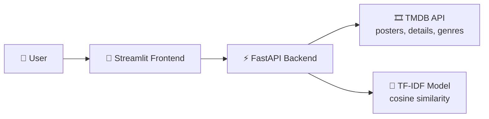

<div align="center">

# 🎬 CineMatch  movie recommendation system

### 🍿 Find your next favourite movie in seconds

*A smart movie recommendation system that suggests movies by **story** and **genre***

**🐍 Python  •  ⚡ FastAPI  •  🎨 Streamlit  •  🧠 Scikit-learn**

<br>

## 👉 [🚀 Open Live Demo] : (https://movie-recommendation-system-njrytitnvkzqvhqqrlee9d.streamlit.app/)👈

</div>

> ⏳ **Note:** The backend runs on a free server, so the first load can take up to a minute while it wakes up.

---

## 🌟 At a Glance

| 🔍 Smart Search | 🤖 Recommendations | 🎭 Genre Picks |
|:---:|:---:|:---:|
| Live suggestions as you type | TF-IDF + cosine similarity | Real-time from TMDB API |

---

## ✨ Features

- 🏠 **Home feed** with Trending, Popular, Top Rated, Now Playing and Upcoming movies
- 🔍 **Keyword search** with live suggestions
- 📄 **Details page** with poster, genres, release date, overview and backdrop
- 🤖 **Similar movies by story** using TF-IDF and cosine similarity
- 🎭 **More like this by genre** fetched live from the TMDB API
- 🌙 **Dark cinematic UI** with poster cards, rating badges and hover effects

---

## 🧠 How It Works



1. 🔎 The user searches for a movie in the Streamlit app.
2. 📡 The app sends a request to the FastAPI backend.
3. 🖼️ The backend fetches posters and details from the TMDB API.
4. 📊 It finds the movie in the local dataset and ranks other movies by cosine similarity on the TF-IDF matrix.
5. 🎭 It also asks TMDB for popular movies in the same genre.
6. 🎬 Everything comes back as clean poster cards.

---

## 🛠️ Tech Stack

| 🧩 Part | 🔧 Tools |
|:---|:---|
| 🐍 Language | Python |
| ⚡ Backend | FastAPI, Uvicorn, httpx, Pydantic |
| 🎨 Frontend | Streamlit, custom CSS |
| 🧠 Machine Learning | Pandas, NumPy, Scikit-learn (TF-IDF, cosine similarity) |
| 🗂️ Data | Movies metadata dataset, TMDB API |
| ☁️ Deployment | Render (backend), Streamlit Community Cloud (frontend), GitHub |

---

## 📁 Project Structure

```
├── main.py              # ⚡ FastAPI backend (endpoints + recommendation logic)
├── app.py               # 🎨 Streamlit frontend
├── df.pkl               # 🗂️ Movies dataframe
├── indices.pkl          # 🔢 Movie title -> row index map
├── tfidf_matrix.pkl     # 📊 TF-IDF matrix of all movies
├── tfidf.pkl            # 🧠 Trained TF-IDF vectorizer
├── movies.ipynb         # 📓 Notebook used to build the model files
├── requirements.txt     # 📦 Python dependencies
└── .gitignore
```

---

## 🚀 Run Locally

**1️⃣ Clone the repo**

```bash
git clone https://github.com/Dineshvishwakarma-02/movie-recommendation-system.git
cd movie-recommendation-system
```

**2️⃣ Create a virtual environment and install packages**

```bash
python -m venv .venv
.venv\Scripts\activate
pip install -r requirements.txt
```

**3️⃣ Add your TMDB API key**

Create a `.env` file in the project folder:

```
TMDB_API_KEY=your_key_here
```

**4️⃣ Start the backend**

```bash
uvicorn main:app --reload
```

**5️⃣ Start the frontend** (in a second terminal)

In `app.py`, set `API_BASE = "http://127.0.0.1:8000"`, then run:

```bash
streamlit run app.py
```

---

## 🔌 API Endpoints

<details>
<summary><b>👉 Click to see all endpoints</b></summary>

<br>

| Endpoint | Description |
|:---|:---|
| `GET /health` | Check that the API is running |
| `GET /home?category=popular&limit=24` | Home feed (trending, popular, top_rated, upcoming, now_playing) |
| `GET /tmdb/search?query=batman` | Keyword search (multiple results) |
| `GET /movie/id/{tmdb_id}` | Movie details |
| `GET /recommend/genre?tmdb_id=123` | Genre-based recommendations |
| `GET /recommend/tfidf?title=Avatar` | TF-IDF recommendations |
| `GET /movie/search?query=Avatar` | Details + TF-IDF + genre recommendations in one call |

Interactive API docs are available at `/docs`.

</details>

---

## ☁️ Deployment

- ⚡ **Backend:** Render Web Service. Start command: `uvicorn main:app --host 0.0.0.0 --port $PORT`, with `TMDB_API_KEY` added as an environment variable.
- 🎨 **Frontend:** Streamlit Community Cloud with `app.py` as the main file.

---

## 👨‍💻 Author

<div align="center">

### **Dinesh Vishwakarma**

🎓 B.Tech CSE  •  🤖 AI/ML Engineer  •  📊 Data Analytics

[💼 LinkedIn](https://www.linkedin.com/in/dinesh-vishwakarma-69b9b6310)  |  [🐙 GitHub](https://github.com/Dineshvishwakarma-02)

<br>

⭐ **If you like this project, please give it a star!** ⭐

<sub>This product uses the TMDB API but is not endorsed or certified by TMDB.</sub>

</div>
